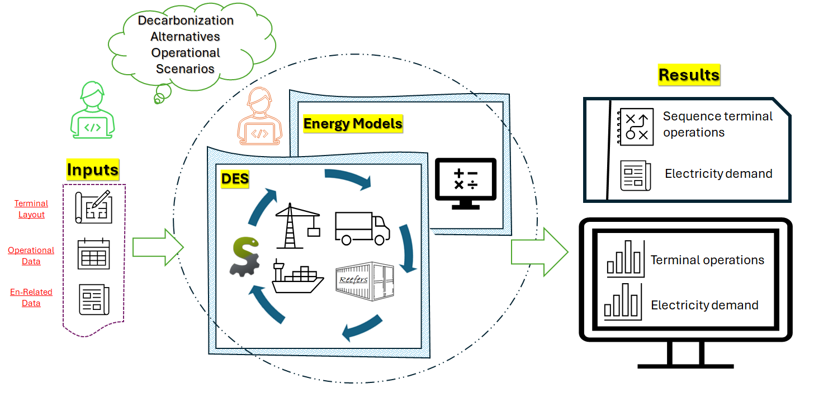
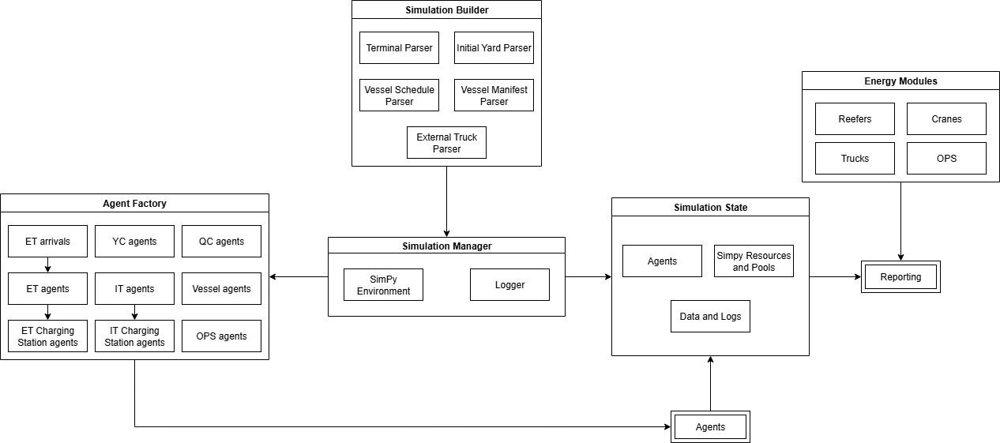

# Terminal Demand Simulator

This project is a sophisticated, event-driven simulation of a container terminal's operations, built using the SimPy framework in Python. It models the complex interactions between various terminal assets, such as vessels, cranes, and trucks, to analyze operational efficiency and, most importantly, energy consumption.

The simulator provides detailed, time-series power profiles for key equipment like Quay Cranes (QCs), Yard Cranes (YCs), refrigerated containers (reefers), and electric trucks. The output is formatted into JSON files suitable for energy grid analysis and optimization studies.

---


### Project Status

This project is currently in **maintenance**. No new features planned, but bugs will be fixed.


### Technology Stack  
  
 - **Language:** Python  
 - **Main Libraries:** SimPy, NumPy, pandas


### Dependencies
The file `requirements.txt` provides all the required external dependencies of the project.

## Installation


 
 Clone the repository
 ```shell
 git clone https://gitlab.inesctec.pt/cpes/european-projects/magpie/wp4modules/terminaldemandsimulator.git
 cd terminaldemandsimulator
 ```
 
 Install dependencies
 ```shell
 pip install -r requirements.txt
 ```


## Usage

To configure the simulation, open `main.py` and modify the following variables as needed:

* **`start_date_str`**: The start date and time of the simulation period (e.g., `'26-09-2022 00:00:00'`).
* **`end_date_str`**: The end date and time of the simulation period (e.g., `'26-09-2022 23:59:59'`).
* **`time_step`**: The granularity for the output reports. Options are `'15min'` or `'1h'`.

Execute the `main.py` script from the project's root directory to run the simulation:

```bash
python main.py
```


## Output Files

Once the simulation completes, check the `output/` directory. Key output files include:

* **`e_trucks.json`**: Power profiles and charging data for all electric trucks.
* **`e_not_flexible_loads.json`**: Power profiles for cranes.
* **`reefers.json`**: Power profiles and thermal data for refrigerated containers.
* **`output/additional/`**: This subdirectory contains:
    * PNG graphs visualizing the power consumption of different asset types.
    * Detailed operational logs and summary text files.


## Architecture Diagrams

### Simulator Framework



### Software Architecture



---

## Open source licensing info

This work is under a [temporary license](docs/license.sav).


## Links for Docs 

Article with presentation of software and case study under review.


## Contacts


* Adrian Carrillo-Galvez (adrian.c.galvez@.inesctec.pt)
* Rui Rodrigues (rui.m.rodrigues@inesctec.pt)
* João Almeida (joao.almeida@inesctec.pt)
* Pedro Costa (pedro.costa@inesctec.pt)
* Tiago Soares (tiago.a.soares@inesctec.pt)
* Zenaida Mourão (zenaida.mourao@inesctec.pt)